<div align="center">



<br/>

[](https://www.nuget.org/packages/com.IvanMurzak.McpPlugin/)[](https://www.nuget.org/packages/com.IvanMurzak.McpPlugin.Server/)[](https://github.com/IvanMurzak/MCP-Plugin-dotnet/actions/workflows/release.yml)

[](#packages)[](https://discord.gg/Cgs6nM8BPU)[](LICENSE)

</div>

**MCP Plugin for .NET** lets a .NET application that is already running (a game editor, a game, a desktop or
server app) expose its methods as [Model Context Protocol](https://modelcontextprotocol.io/) **tools**,
**prompts** and **resources**. Usual MCP servers are started by the AI client as a subprocess; this one splits the
work in two: a small library inside your app, and a bridge server that the AI client talks to. The app connects to
the bridge over SignalR and keeps working on its own lifecycle. It powers [Unity-MCP](https://github.com/IvanMurzak/Unity-MCP).

<p align="center">
  
</p>

## Packages

All three share one version and are released together.

| Package | Targets | Use it in |
| --- | --- | --- |
| [`com.IvanMurzak.McpPlugin`](https://www.nuget.org/packages/com.IvanMurzak.McpPlugin/) | netstandard2.1, net8.0, net9.0 | Your app: declares tools, prompts and resources and connects to the server |
| [`com.IvanMurzak.McpPlugin.Server`](https://www.nuget.org/packages/com.IvanMurzak.McpPlugin.Server/) | net8.0, net9.0 | The bridge: an ASP.NET Core host for the SignalR hub and the MCP endpoints |
| [`com.IvanMurzak.McpPlugin.Common`](https://www.nuget.org/packages/com.IvanMurzak.McpPlugin.Common/) | netstandard2.1 | Shared models and settings; referenced by the other two |

## Features

✅ **Attributes** — `[AiTool]`, `[AiPrompt]`, `[AiResource]` on plain C# methods<br>
✅ **Any .NET type** — ReflectorNet builds schemas and binds nested objects, lists, enums<br>
✅ **Lives with your app** — SignalR link with auto-reconnect; catalog kept during reloads<br>
✅ **Two MCP transports** — `stdio` or streamable HTTP on `/mcp`<br>
✅ **REST** — `GET /api/tools` and `POST /api/tools/{name}` for scripts and tests<br>
✅ **Editor and game** — editor and runtime connections side by side<br>
✅ **Tool annotations** — title plus read-only, destructive, idempotent, open-world hints<br>
✅ **Skill files** — a `SKILL.md` per tool in a `SKILLS/` folder<br>
✅ **Auth and hooks** — `none` / `token` / `oauth` modes, analytics and auth webhooks

## Install

```bash
dotnet add package com.IvanMurzak.McpPlugin          # in your app
dotnet add package com.IvanMurzak.McpPlugin.Server   # in the bridge host (or run DemoWebApp)
```

## Quick start

**1. Declare tools, prompts and resources.** A class is scanned only when it carries the matching
`[Ai*Type]` attribute. `[Description]` text is what the AI agent reads.

```csharp
using System.ComponentModel;
using com.IvanMurzak.McpPlugin;
using com.IvanMurzak.McpPlugin.Common.Model;

[AiToolType]
public static class GameTools
{
    [AiTool("add", "Add numbers", ReadOnlyHint = true)]   // name, title
    [Description("Adds two numbers.")]
    public static int Add(
        [Description("First number.")] int a,
        [Description("Second number.")] int b) => a + b;
}

[AiPromptType]
public static class GamePrompts
{
    [AiPrompt(Name = "review-scene")]
    [Description("Asks the agent to review the open scene.")]
    public static string ReviewScene(string focus = "performance")
        => $"Review the open scene. Focus on {focus}.";
}

[AiResourceType]
public static class GameResources
{
    [AiResource(Route = "app://status", Name = "app-status", MimeType = "text/plain",
        ListResources = nameof(ListStatus))]
    [Description("Current application status.")]
    public static ResponseResourceContent[] GetStatus(string uri)
        => new[] { ResponseResourceContent.CreateText(uri, "Running", "text/plain") };

    public static ResponseListResource[] ListStatus()
        => new[] { new ResponseListResource("app://status", "app-status") };
}
```

**2. Build the plugin and connect it.**

```csharp
using System;
using com.IvanMurzak.McpPlugin;
using com.IvanMurzak.McpPlugin.Common;
using com.IvanMurzak.ReflectorNet;
using Version = com.IvanMurzak.McpPlugin.Common.Version;

var version = new Version { Api = Consts.ApiVersion, Plugin = "1.0.0", Environment = "MyApp" };
var assembly = typeof(GameTools).Assembly;

var plugin = new McpPluginBuilder(version)
    .WithConfig(config =>
    {
        config.Host = "http://localhost:8080";                  // the McpPlugin.Server address
        config.ProjectRootPath = Environment.CurrentDirectory;  // where SKILLS/ is written
    })
    .WithToolsFromAssembly(assembly)
    .WithPromptsFromAssembly(assembly)
    .WithResourcesFromAssembly(assembly)
    .Build(new Reflector());

await plugin.Connect(); // reconnects on its own while KeepConnected is true (the default)
```

`Api` must match the server's API version, so pass `Consts.ApiVersion` from the package you reference.

**3. Run the server.** Use the demo host from this repository:

```bash
cd DemoWebApp
dotnet run -- port=8080 client-transport=streamableHttp
```

or host it in your own ASP.NET Core app:

```csharp
using com.IvanMurzak.McpPlugin.Common.Utils;
using com.IvanMurzak.McpPlugin.Server;
using Microsoft.AspNetCore.Builder;

var dataArguments = new DataArguments(args); // port=, client-transport=, auth=, ...

var builder = WebApplication.CreateBuilder(args);
builder.Services
    .WithMcpServer(dataArguments)
    .WithMcpPluginServer(dataArguments);
builder.WebHost.UseKestrelForMcpPlugin(dataArguments.Port, dataArguments.Bind);

var app = builder.Build();
app.UseMcpPluginServer(dataArguments);
app.Run();
```

**4. Connect an AI agent.** Point an MCP client at `http://localhost:8080/mcp`, or let it launch the server
with `client-transport=stdio`. Scripts can call a tool directly:

```bash
curl -X POST http://localhost:8080/api/tools/add -H "Content-Type: application/json" -d '{"a":2,"b":3}'
# {"status":"success","structured":{"result":5}}
```

## Writing good tools

- **Annotate.** Give each tool a `Title` and an explicit `ReadOnlyHint` or `DestructiveHint`; MCP tool
  directories reject tools without them. `AiToolAnnotationsValidator.Validate(assembly)` lists the gaps in a unit test.
- **Fail clearly.** Throw an exception with a message the agent can act on, or return
  `ResponseCallTool.Error(message)`. Throw `ToolUnavailableException` while the host is busy (compiling,
  reloading). How each case is reported: [docs/tool-errors.md](docs/tool-errors.md).
- **Game-only tools.** Mark them `[AiToolType(Target = ToolTarget.Runtime)]` and set
  `config.ClientRole = ClientRole.Runtime` in the game build, before `Build()`.

## Documentation

| Page | What is in it |
| --- | --- |
| [Configuration](docs/configuration.md) | Every server argument and environment variable, plugin settings, webhooks, Docker |
| [Tool errors](docs/tool-errors.md) | How tool failures map to MCP results and HTTP status, by version |
| [Transport and auth](docs/architecture-transport-auth.md) | `stdio` / streamable HTTP and the `none` / `token` / `oauth` modes in depth |
| [Migrating to 8.0.0](docs/migration-8.0.0.md) | The `CancellationToken` change in the prompt and resource hubs |
| [NullEngine](McpPlugin.NullEngine/README.md) | An engine-free test host with a fixed tool set |
| [Chain fixtures](docs/chain-fixtures.md) | Recording and replaying a plugin's catalog for downstream tests |

The legacy `[McpPluginTool]`, `[McpPluginPrompt]`, `[McpPluginResource]` names still compile as `[Obsolete]`
aliases of the `[Ai*]` attributes.

## Build from source

```bash
dotnet build McpPlugin.sln
dotnet test
```

Runnable samples: [`DemoWebApp`](DemoWebApp) (server) and [`DemoConsoleApp`](DemoConsoleApp) (plugin with one tool).

## Community

Questions and ideas: [Discord](https://discord.gg/Cgs6nM8BPU) or [GitHub issues](https://github.com/IvanMurzak/MCP-Plugin-dotnet/issues).

## License

[Apache-2.0](LICENSE) © Ivan Murzak

<div align="center">
  <a href="https://stand-with-ukraine.pp.ua"></a>
</div>
